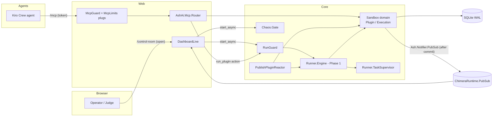
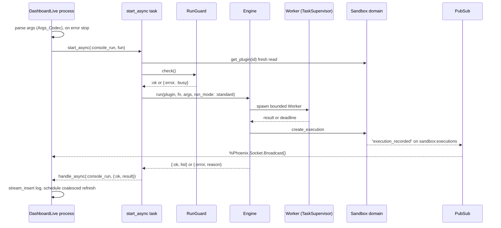
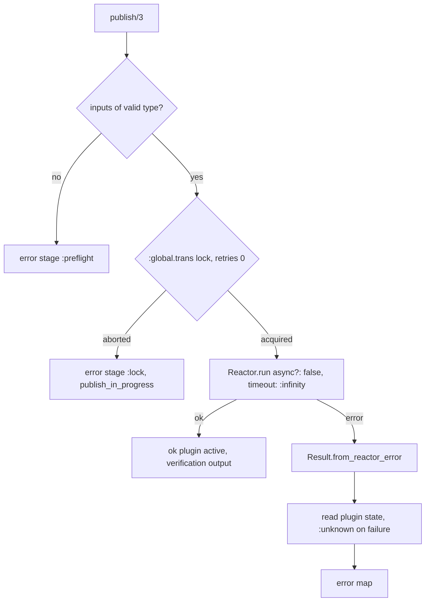

# Design Document

## Overview

Phase 2 adds three things on top of the Phase 1 Poltergeist Sandbox, without changing the Engine or the Worker:

1. `ChimeraRuntimeWeb.DashboardLive` at `/control-room`: a Registry_Panel (Cinder table), a Console_Panel, and a Vitals_Panel with the Chaos_Chamber. It updates from Phoenix PubSub events.
2. `ChimeraRuntime.Orchestration.PublishPluginReactor`: an Ash.Reactor saga that moves a Plugin `:draft` to `:compiling`, runs one Gravedigger verification, then moves it to `:active`. Any failure after the compile transition quarantines the Plugin.
3. An MCP server at `/mcp`, exposed from the Sandbox_Domain through `ash_ai`, with four tools.

### Key design decisions

| Decision | Rationale |
| --- | --- |
| Publish events with `Ash.Notifier.PubSub` and `ChimeraRuntimeWeb.Endpoint` as the broadcast module | Ash sends notifications after the transaction commits, so subscribers never see rolled-back data. The Endpoint delivers `%Phoenix.Socket.Broadcast{}` on `ChimeraRuntime.PubSub` (the endpoint's `pubsub_server`). The Engine source is untouched. |
| Event payloads are small maps built by pure functions | The payload never carries `input_json`, `output_json`, `wasm_binary`, or `source_code`. Pure builders are property-testable. |
| Every `Engine.run/4` call and every Sandbox_Domain write from the Control_Room runs inside `start_async` | The LiveView process stays responsive, and a Worker timeout or crash cannot touch the socket. |
| The Chaos_Gate is a `GenServer` that owns state and delegates every decision to a pure function | The process makes the gate global across sessions. The pure function is property-testable. The gate monitors the process that acquired it, so an abnormal exit still releases the slot. |
| The saga uses custom `Reactor.Step` modules, not `ash_update` steps | Ash.Reactor's `ash_update` passes a `changeset` argument to its undo action, and the Phase 1 `:quarantine` action does not declare it. A custom `undo/4` can re-read the Plugin and call the existing `quarantine_plugin` interface. |
| The saga always runs with `async?: false` and `timeout: :infinity` | SQLite has one writer. Compensation order stays deterministic. No saga-wide timeout can kill the saga before compensation runs (Requirement 11, criterion 11). |
| The Control_Room is open, with its route in a named pipeline `:control_room_access` | User decision for the hackathon demo. One pipeline is the single place to add auth later. |
| `/mcp` stays guarded by a token, an Origin check, and a body-size check | `/mcp` can run and quarantine Plugins, and agents are its only intended callers. |

### Demo_Exposure_Note (unauthenticated Control_Room)

The route `/control-room` has no authentication in Phase 2. This was a deliberate user decision so that hackathon judges can open the live demo immediately. The risk is real:

- Any visitor can run active Plugins through the Console_Panel.
- Any visitor can trigger the Chaos_Chamber.
- Any visitor can read Plugin names, states, and run statistics.

What bounds the cost: the Run_Capacity_Guard (default 8 concurrent Workers) and the Chaos_Gate (one in-flight run, 2000 ms cooldown). These limit load. They do not give access control or confidentiality. The page never shows `wasm_binary` or `source_code`, and has no button that edits, destroys, or quarantines a Plugin (Requirement 1, criterion 15).

How to change it later: add a plug to `pipeline :control_room_access` in the router (for example `Plug.BasicAuth` or a session check). Nothing else changes. The note is repeated in the `DashboardLive` `@moduledoc`, in a router comment, and in the on-page banner "Demo mode: open access".

### Research summary

| Topic | Finding | Source |
| --- | --- | --- |
| Cinder 0.18.1 | `Cinder.collection/1` accepts `query` (or `resource`), `id`, `page_size`, `theme`, `query_opts`, `initial_load` (async by default), `on_query_change`, and slots `:col` (`field`, `filter`, `sort`, `label`), `:empty`, `:error`, `:loading`. `Cinder.Refresh.refresh_table/3` takes `silent: true`, keeps rows visible, and logs (does not display) a failed silent refresh. | Verified in `deps/cinder/lib/cinder/collection.ex` and `refresh.ex` |
| `Ash.Notifier.PubSub` (Ash 3.37.4) | Section `pub_sub` with `module`, `prefix`, `broadcast_type` (default `:notification`), `publish action, topic, event:, transform:`. Without `name`, it calls `module.broadcast(topic, event, payload)` where payload is the `transform` result. Topic is `prefix <> ":" <> topic`. | Verified in `deps/ash/lib/ash/notifier/pub_sub/pub_sub.ex` and `publication.ex` |
| Reactor 1.0.7 | `Reactor.Step` callbacks `run/3`, `compensate/4`, `undo/4`. `undo/4` may return `:ok`, `:retry`, `{:retry, reason}`, or `{:error, reason}`. The executor retries an undo at most 5 times, then reports `UndoRetriesExceededError`. Failed undo reports `UndoStepError`. `Reactor.run/4` takes `async?` and `timeout` options. A step's `max_retries` defaults to `:infinity` for `run`, so the custom steps return `{:error, _}` (not `:retry`) from `run/3`. | Verified in `deps/reactor/lib/reactor/step.ex`, `executor.ex`, `executor/step_runner.ex` |
| `ash_ai` 1.5.4 | Domain extension `AshAi` with a `tools` section. `tool name, resource, action` takes `description`, `title`, `select`, `load`, `load_strict?`, `get_by`, `identity`, `filterable_fields`, `sortable_fields`, `aggregatable_fields`, `action_parameters`, `annotations`, and nested `argument`. `AshAi.Mcp.Router` is a Plug mounted with `forward "/mcp", AshAi.Mcp.Router, tools: [...], otp_app: :app`. It also takes `tool_argument_transformer` and `tool_definition_transformer` (3-arity functions) and emits `[:ash_ai, :mcp, :tool_call]` telemetry. | [AshAi DSL docs](https://ash-ai.hexdocs.pm/dsl-ashai.html) and [AshAi.Mcp.Router docs](https://ash-ai.hexdocs.pm/AshAi.Mcp.Router.html) (content rephrased for compliance with licensing restrictions) |
| `ash_ai` dependencies | `ash_ai` 1.5.4 requires `ash_json_api >= 1.4.27` and `open_api_spex ~> 3.0`. `ash_json_api` 1.8.0 requires `json_xema ~> 0.4`, which requires `xema ~> 0.16` and `conv_case ~> 0.2`. The user APPROVED all six resulting `mix.lock`-only additions (`ash_ai`, `ash_json_api`, `open_api_spex`, `json_xema`, `xema`, `conv_case`). The only `mix.exs` change is the single `ash_ai` exact-pin line. | Hex package metadata, checked while writing this design; user decision |

`deps/ash_ai` does not exist yet. Every `ash_ai` fact above comes from hexdocs for version 1.5.4. Task 1.2 re-verifies each fact against the pinned source in `deps/ash_ai` before any MCP code is written (Requirement 14, criterion 16).

## Architecture



### Process and data flow



### Supervision tree additions (`application.ex`)

New children, placed after `{Phoenix.PubSub, ...}` and before the Endpoint: `ChimeraRuntime.Chaos.Gate`. Nothing else is supervised: the saga lock uses `:global.trans/4`, and the RunGuard is a stateless module.

## Components and Interfaces

### Module map

| Module | File | Kind | Responsibility |
| --- | --- | --- | --- |
| `ChimeraRuntimeWeb.DashboardLive` | `lib/chimera_runtime_web/live/dashboard_live.ex` | LiveView | Mount, events, `start_async`, PubSub handling |
| `ChimeraRuntimeWeb.ControlRoomComponents` | `lib/chimera_runtime_web/live/control_room_components.ex` | Function components | Panels, banner, console result, chaos result, log entry |
| `ChimeraRuntimeWeb.ControlRoom.ArgsCodec` | `lib/chimera_runtime_web/control_room/args_codec.ex` | Pure | `parse/1`, `print/1` |
| `ChimeraRuntimeWeb.ControlRoom.Format` | `lib/chimera_runtime_web/control_room/format.ex` | Pure | `duration/1`, `parse_duration/1`, `bytes/1`, `percent/1` |
| `ChimeraRuntimeWeb.ControlRoom.Refresh` | `lib/chimera_runtime_web/control_room/refresh.ex` | Pure | Coalescing decision |
| `ChimeraRuntime.Vitals` | `lib/chimera_runtime/vitals.ex` | VM reads + pure helpers | `collect/1`, `utilization_percent/1` |
| `ChimeraRuntime.RunGuard` | `lib/chimera_runtime/run_guard.ex` | Module | `check/0`, `decide/2` |
| `ChimeraRuntime.Chaos.Gate` | `lib/chimera_runtime/chaos/gate.ex` | GenServer + pure `decide/3` | Single-flight and cooldown |
| `ChimeraRuntime.Chaos.Plugin` | `lib/chimera_runtime/chaos/plugin.ex` | Module | `wasm/0` byte literal, `ensure_active/0` |
| `ChimeraRuntime.Sandbox.EventPayload` | `lib/chimera_runtime/sandbox/event_payload.ex` | Pure | `execution/1`, `plugin/1` |
| `ChimeraRuntime.Sandbox.Plugin.Run` | `lib/chimera_runtime/sandbox/plugin/run.ex` | Generic action implementation | MCP `run_plugin` |
| `ChimeraRuntime.Sandbox.Types.WasmNumber` | `lib/chimera_runtime/sandbox/types/wasm_number.ex` | Ash type (union of integer and float) | Typed MCP `args` elements |
| `ChimeraRuntime.Orchestration.PublishPluginReactor` | `lib/chimera_runtime/orchestration/publish_plugin_reactor.ex` | Ash.Reactor | The saga and `publish/3` |
| `ChimeraRuntime.Orchestration.Steps.{LoadPlugin,BeginCompile,Verify,Promote}` | `lib/chimera_runtime/orchestration/steps/*.ex` | `Reactor.Step` | The four steps |
| `ChimeraRuntime.Orchestration.Result` | `lib/chimera_runtime/orchestration/result.ex` | Pure | Error unwrapping and `Saga_Result` shaping |
| `ChimeraRuntimeWeb.Plugs.McpGuard` | `lib/chimera_runtime_web/plugs/mcp_guard.ex` | Plug + pure `decide/1` | Origin, token, loopback, body size |
| `ChimeraRuntimeWeb.Plugs.McpLimits` | `lib/chimera_runtime_web/plugs/mcp_limits.ex` | Plug + pure `clamp_limit/1` | Caps `list_plugins` limit at 100 |

Phase 1 modules that change (Requirement 16, criterion 4): `Plugin` (add `Ash.Notifier.PubSub`, `pub_sub` section, generic action `:run`), `Execution` (add `Ash.Notifier.PubSub`, `pub_sub` section), `Sandbox` domain (add `AshAi`, `tools`, code interfaces), `application.ex` (new child). `engine.ex` and `worker.ex` are not touched.

### Event payload builders (`EventPayload`)

```elixir
@spec execution(Ash.Notifier.Notification.t() | Execution.t()) :: map()
# keys: :id, :plugin_id, :status, :run_mode, :duration_ms, :error_reason, :inserted_at
# error_reason: nil | String.t() truncated to 200 chars (String.slice/2, so codepoints)

@spec plugin(Ash.Notifier.Notification.t() | Plugin.t()) :: map()
# keys: :id, :name, :state, :action, :updated_at
```

`EventPayload.valid_execution?/1` and `EventPayload.valid_plugin?/1` check that a received payload has the exact key set and value types of this contract. `DashboardLive` uses them to ignore malformed messages (Requirement 6, criterion 7).

The `transform` option of each publication calls the two builders. `plugin/1` takes the action name from `notification.action.name`. When given a bare `Plugin` struct (in property tests), `:action` is `nil`.

### PubSub contract

Declared on the resources (section order follows `config/config.exs`: `pub_sub` comes after `actions`):

```elixir
# Execution
use Ash.Resource, ..., notifiers: [Ash.Notifier.PubSub]

pub_sub do
  module ChimeraRuntimeWeb.Endpoint
  prefix "sandbox"

  publish :create, "executions",
    event: "execution_recorded",
    transform: &ChimeraRuntime.Sandbox.EventPayload.execution/1
end

# Plugin: one publish per transition action; :mark_verification_used is deliberately absent
pub_sub do
  module ChimeraRuntimeWeb.Endpoint
  prefix "sandbox"

  publish :create, "plugins", event: "plugin_changed", transform: &EventPayload.plugin/1
  publish :update, "plugins", event: "plugin_changed", transform: &EventPayload.plugin/1
  publish :compile, "plugins", event: "plugin_changed", transform: &EventPayload.plugin/1
  publish :activate, "plugins", event: "plugin_changed", transform: &EventPayload.plugin/1
  publish :quarantine, "plugins", event: "plugin_changed", transform: &EventPayload.plugin/1
end
```

Spark DSL sections take literal entries, so the five `publish` lines are written out.

| Topic | Event | Payload keys | Trigger |
| --- | --- | --- | --- |
| `sandbox:executions` | `"execution_recorded"` | `id, plugin_id, status, run_mode, duration_ms, error_reason, inserted_at` | Execution `:create` committed |
| `sandbox:plugins` | `"plugin_changed"` | `id, name, state, action, updated_at` | Plugin `:create, :update, :compile, :activate, :quarantine` committed |

Delivery: `ChimeraRuntimeWeb.Endpoint.broadcast(topic, event, payload)` produces `%Phoenix.Socket.Broadcast{topic: topic, event: event, payload: payload}` on `ChimeraRuntime.PubSub`. A rejected action produces no notification, so no event is sent (Requirement 5, criterion 10). A failing broadcast is not allowed to change the Engine result: the Engine already wraps persistence in its Phase 1 safe-record path, which logs and continues (Requirement 5, criterion 9). The task that adds the notifier includes a test that forces a broadcast failure.

### DashboardLive structure

```elixir
defmodule ChimeraRuntimeWeb.DashboardLive do
  @moduledoc "... Demo_Exposure_Note ..."
  use ChimeraRuntimeWeb, :live_view
```

Assigns (set in `mount/3`):

| Assign | Type | Purpose |
| --- | --- | --- |
| `:registry_query` | `Ash.Query.t()` | `Ash.Query.select(Plugin, [:id, :name, :state, :timeout_ms])`. Excludes `wasm_binary` and `source_code`. Aggregates come from the column fields. |
| `:active_plugins` | `AsyncResult` | Selector options, loaded with `assign_async/3` (never a read in `mount` of the static render path) |
| `:console_form` | `Phoenix.HTML.Form` | `to_form(%{"plugin_id" => "", "function_name" => "", "args" => ""}, as: :console)` |
| `:console` | `:idle \| :running \| {:done, map} \| {:rejected, term}` | Console state |
| `:chaos` | `:idle \| :running \| {:done, map} \| {:rejected, term}` | Chaos state |
| `:vitals` | `map` | Last good sample |
| `:vitals_stale?` | `boolean` | Stale marker |
| `:last_sched_sample` | `term` | Previous `:scheduler.sample_all/0` value |
| `:refresh_ref` | `reference \| nil` | Pending coalesced refresh timer |
| `:selector_dirty?` | `boolean` | Plugin event arrived in the window |
| stream `:log` | stream, `limit: 50`, `at: 0` | Execution_Log |

Mount (connected only): `Phoenix.PubSub.subscribe(ChimeraRuntime.PubSub, "sandbox:executions")`, `... "sandbox:plugins"`, `:timer.send_interval(1000, :vitals_tick)`, `:timer.send_interval(30_000, :fallback_refresh)`. The disconnected render does none of these (Requirement 1, criterion 8). `:timer.send_interval` timers are tied to the calling process and are removed when it ends.

Callbacks:

| Callback | Behavior |
| --- | --- |
| `handle_event("console_validate", ...)` | Re-parses args with `ArgsCodec`, updates form errors. No Engine call. |
| `handle_event("console_run", params, socket)` | `ArgsCodec.parse/1`. On error, sets the form error and returns. On success, sets `:console` to `:running` and calls `start_async(:console_run, fn -> run_console(plugin_id, fname, args) end)`. |
| `handle_event("inject_chaos", _, socket)` | Sets `:chaos` to `:running` and calls `start_async(:chaos_run, fn -> run_chaos() end)`. Captures `lv = self()` before the call. |
| `handle_async(:console_run, {:ok, result}, socket)` | Stores `{:done, result}` or `{:rejected, reason}`. |
| `handle_async(:console_run, {:exit, reason}, socket)` | Stores a readable error and clears `:running` (Requirement 4, criterion 11). |
| `handle_async(:chaos_run, {:ok, result}, socket)` | Compares `lv` and `self()` to produce "LiveView process unchanged". |
| `handle_info(%Phoenix.Socket.Broadcast{topic: "sandbox:executions", event: "execution_recorded", payload: p}, socket)` | If `EventPayload.valid_execution?(p)`: `stream_insert(socket, :log, entry(p), at: 0, limit: 50)` and `schedule_refresh/1`. Otherwise ignore. |
| `handle_info(%Phoenix.Socket.Broadcast{topic: "sandbox:plugins", event: "plugin_changed", payload: p}, socket)` | Valid: set `selector_dirty?`, `schedule_refresh/1`. Otherwise ignore. |
| `handle_info(%Phoenix.Socket.Broadcast{}, socket)` and `handle_info(_other, socket)` | Ignore. |
| `handle_info(:flush_refresh, socket)` | `Cinder.Refresh.refresh_table(socket, "plugin-registry", silent: true)`, reload `:active_plugins` if `selector_dirty?`, clear `:refresh_ref`. |
| `handle_info(:fallback_refresh, socket)` | Same refresh without a log insert. |
| `handle_info(:vitals_tick, socket)` | `Vitals.collect(prev_sample)`. On `{:ok, map, sample}` update. On `:error`, set `vitals_stale?`. |

`run_console/3` and `run_chaos/0` execute in the async task, not in the LiveView:

```elixir
defp run_console(plugin_id, fname, args) do
  with {:ok, plugin} <- Sandbox.get_plugin(plugin_id),
       :ok <- RunGuard.check() do
    t0 = System.monotonic_time()
    result = Engine.run(plugin, fname, args, run_mode: :standard)
    {:ran, result, wall_us(t0)}
  else
    {:error, :busy} -> {:rejected, :busy}
    {:error, reason} -> {:rejected, {:read_failed, reason}}
  end
end
```

`run_chaos/0` does, in order: check the Fuel_Budget is a positive integer; `Gate.acquire(self())` (the gate monitors the task process); `Chaos.Plugin.ensure_active/0` (creates, compiles, and activates the `chaos-chamber` Plugin when absent; reports the state when the Plugin exists in a state other than `:active`); `RunGuard.check/0`; `Engine.run/4`; `Gate.release(ref)` in an `after` clause. Because the gate monitors the task, a task killed with the LiveView still releases the slot and starts the cooldown (Requirement 8, criterion 12).

Template skeleton (HEEx, in `render/1` or a colocated file):

```heex
<Layouts.app flash={@flash}>
  <.demo_banner />               <%!-- "Demo mode: open access" --%>
  <.registry_panel registry_query={@registry_query} />
  <.console_panel form={@console_form} plugins={@active_plugins} state={@console} />
  <.vitals_panel vitals={@vitals} stale?={@vitals_stale?} chaos={@chaos} log={@streams.log} />
</Layouts.app>
```

Form fields use `<.input field={@form[:function_name]} ...>` and `<.input type="textarea" ...>`. Icons use `<.icon name="hero-play" />`. The execution log container has `id="execution-log" phx-update="stream"` and each entry has a stream id. Custom CSS (if any) goes in `assets/css/app.css` as plain rules, with no `@apply`.

### Cinder usage (verified against `deps/cinder`)

```heex
<Cinder.collection
  id="plugin-registry"
  query={@registry_query}
  page_size={10}
  theme="daisy_ui"
>
  <:col :let={p} field="name" filter sort label="Name">
    {p.name}
    <span :if={p.name == "chaos-chamber"} class="badge badge-warning badge-sm">system</span>
  </:col>
  <:col :let={p} field="state" filter={:select} sort label="State">{p.state}</:col>
  <:col :let={p} field="timeout_ms" label="Timeout">{p.timeout_ms} ms</:col>
  <:col :let={p} field="total_runs" sort label="Runs">{p.total_runs}</:col>
  <:col :let={p} field="failure_rate" sort label="Failure rate">{Format.percent(p.failure_rate)}</:col>
  <:col :let={p} field="avg_duration_ms" sort label="Avg ms">{Format.avg_ms(p.avg_duration_ms)}</:col>
  <:empty>No plugins yet</:empty>
  <:error>Registry unavailable, retrying</:error>
</Cinder.collection>
```

- `query` (not `resource`) is used so that `select` excludes the binary and the source. Cinder documents `resource` and `query` as alternatives, never both.
- The `theme` attribute defaults from `config :cinder, default_theme: "daisy_ui"`, so setting it again is optional.
- Column fields that are aggregates or calculations (`total_runs`, `failure_rate`, `avg_duration_ms`) are loaded by Cinder because they are column fields.
- `initial_load` is async by default, so tests call `render_async/1`.
- A task checks the exact select and the exclusion of `wasm_binary` by passing `on_query_change` and asserting on the received `%{query: query}` (Cinder sends `{event, %{query: Ash.Query.t(), count: _, id: _}}` to the parent), or equivalently by asserting on `registry_query` in the assigns.
- `Cinder.Refresh.refresh_table(socket, "plugin-registry", silent: true)` is the only refresh call. A failed silent refresh keeps rows and logs the error. A failed non-silent first load shows the `:error` slot (Requirement 2, criterion 9).

### Refresh coalescing (`Refresh`)

```elixir
@spec on_event(ref :: reference() | nil, delay_ms :: pos_integer()) ::
        {:schedule, delay_ms} | :already_scheduled
```

State is the `:refresh_ref`. `nil` means schedule (`Process.send_after(self(), :flush_refresh, 250)` and store the ref). A non-nil ref means no new timer. `:flush_refresh` clears the ref. N events inside one window therefore make one refresh (Requirement 6, criteria 3 and 4).

### Pure helpers

- `ArgsCodec.parse(text)`: size check on `byte_size/1` first (`> 4096` returns `{:error, :too_large}` without decoding). Blank text returns `{:ok, []}`. Otherwise `Jason.decode/1` with no `keys: :atoms` option (Jason creates no atoms for values), then shape checks: not a list returns `{:error, {:not_array, kind}}`; more than 64 elements returns `{:error, {:too_many, n}}`; a non-number element returns `{:error, {:bad_element, index, kind}}`. Decode errors return `{:error, :invalid_json}`. The function is wrapped so that no input raises.
- `ArgsCodec.print(list)`: `Jason.encode!/1` on a list of finite numbers.
- `Format.duration(us)`: below 1000, `"#{us} µs"`. Otherwise `"#{div(us, 1000)}.#{pad3(rem(us, 1000))} ms"`. Integer arithmetic keeps the round trip exact. `Format.parse_duration/1` is the inverse and is used by the test.
- `Format.bytes(n)`: units `B, KiB, MiB, GiB, TiB`. Divides by 1024 until the value is below 1024 or the largest unit is reached. Output is a string like `"1.5 MiB"`.
- `Vitals.collect(prev)`: reads `:erlang.memory/0`, `:erlang.system_info(:schedulers_online)`, `:erlang.system_info(:dirty_cpu_schedulers_online)`, `:erlang.statistics(:total_run_queue_lengths)`, `:erlang.system_info(:process_count)`, `Supervisor.count_children(ChimeraRuntime.Runner.TaskSupervisor).active`, and `:scheduler.sample_all/0`. Utilization is `:scheduler.utilization(prev, current)` total, multiplied by 100 and clamped by `utilization_percent/1`. The whole read is wrapped in `try/rescue/catch` and returns `:error` on failure. The key set is fixed.
- `RunGuard.decide(active, max)`: `:ok` when `active < max`, otherwise `{:error, :busy}`. `check/0` reads the count and `max_workers` (config key `config :chimera_runtime, ChimeraRuntime.RunGuard, max_workers: 8`) and calls `decide/2`. It holds no lock (soft limit).
- `Gate.decide(state, event, now)`: state is `%{in_flight: nil | reference, last_end: nil | integer}`. Events: `:acquire`, `:release`. Returns `{:ok, new_state}` or `{:error, :in_flight}` or `{:error, {:cooldown, remaining_ms}}`. `now` is monotonic milliseconds.

### Chaos_Plugin

`ChimeraRuntime.Chaos.Plugin.wasm/0` holds the infinite-loop module as a byte literal in `lib/`. It is the same module as `ChimeraRuntime.WasmFixtures.infinite_loop/0` (a test checks equality; Requirement 17, criterion 15). `timeout_ms` is read from `config :chimera_runtime, :chaos, deadline_ms: 250` and validated to the range 10 to 1000. `ensure_active/0` uses the Sandbox_Domain interfaces `create_plugin`, `compile_plugin`, `activate_plugin`. It never runs the Gravedigger. Create races (two sessions) are handled by treating a unique-name error as "read the existing Plugin".

### Publish saga

```elixir
defmodule ChimeraRuntime.Orchestration.PublishPluginReactor do
  use Ash.Reactor

  ash do
    default_domain ChimeraRuntime.Sandbox
  end

  input :plugin_id
  input :function_name
  input :args

  step :load_plugin, Steps.LoadPlugin do
    argument :plugin_id, input(:plugin_id)
    argument :function_name, input(:function_name)
    argument :args, input(:args)
    async? false
    max_retries 0
  end

  step :begin_compile, Steps.BeginCompile do
    argument :plugin, result(:load_plugin)
    async? false
    max_retries 0
  end

  step :verify, Steps.Verify do
    argument :plugin, result(:begin_compile)
    argument :function_name, input(:function_name)
    argument :args, input(:args)
    async? false
    max_retries 0
  end

  step :promote, Steps.Promote do
    argument :plugin, result(:begin_compile)
    argument :verification, result(:verify)
    async? false
    max_retries 0
  end

  return :promote
end
```

The DSL names above (`input`, `step ... do argument ... end`, `async?`, `max_retries`, `return`) are the Reactor DSL, which the task re-checks against `deps/reactor` when it writes the module. Using `result(:begin_compile)` as the `:verify` argument gives `:verify` a dependency on the compile step. Without it, Reactor could schedule steps by data dependency only.

#### Step contracts

| Step | `run/3` | `undo/4` |
| --- | --- | --- |
| `LoadPlugin` | Validates with `Engine.validate_input(plugin, fname, args, run_mode: :verification)`. Reads the Plugin by id (`Sandbox.get_plugin/1`, not found maps to `:not_found`). Rejects state other than `:draft` with `{:invalid_state, state}`, a nil or empty `wasm_binary` with `:missing_binary`, and `verification_used == true` with `:verification_already_used`. Returns `{:ok, plugin}`. All errors are `{:error, %StageError{stage: :preflight, reason: r}}`. | none |
| `BeginCompile` | `Sandbox.compile_plugin(plugin)`. On error returns `{:error, %StageError{stage: :compile, ...}}`. | Re-reads the Plugin. State `:quarantined` returns `:ok`. Otherwise calls the configured quarantine function (default `Sandbox.quarantine_plugin/1`). A transient error (SQLite "database is locked", detected by `Exception.message/1` matching `"database is locked"` or `"busy"`) returns `:retry`. Any other error returns `{:error, reason}` and logs once with the plugin id. |
| `Verify` | Re-reads the Plugin by id. Calls the configured runner (default `&Engine.run/4`) with `run_mode: :verification`. `{:ok, output}` returns `{:ok, %{output: output}}`. `{:error, reason}` returns `{:error, %StageError{stage: :verify, reason: reason}}`. Wrapped in `try/rescue/catch` so raise, exit, and throw become `StageError`. | none |
| `Promote` | Re-reads the Plugin, calls `Sandbox.activate_plugin/1`. Returns `{:ok, plugin}` (state `:active`). Errors become `StageError{stage: :promote}`. | none |

The compensation belongs to `BeginCompile` because Reactor stores a step's undo only after the step succeeds. The compensation therefore runs when `:verify` or `:promote` fails, and never when `:load_plugin` or `:begin_compile` fails (Requirement 12, criteria 1, 8, and 9). Reactor retries an undo that returns `:retry` up to 5 times, then reports `UndoRetriesExceededError`.

Plugin freshness: each step re-reads the Plugin by id because the verification marker (`mark_verification_used`) is an atomic update that makes the in-memory struct stale.

#### `publish/3`

```elixir
@spec publish(term(), term(), term()) :: {:ok, map()} | {:error, map()}
def publish(plugin_id, function_name, args \\ [])
```



- Lock: `:global.trans({{:chimera_publish, plugin_id}, self()}, fun, [node()], 0)`. It returns `:aborted` when another process holds the lock. `:global.trans/4` releases the lock in an `after` clause, so any result, including a raise, releases it (Requirement 13, criterion 6).
- Totality: the body is wrapped so that no input and no raise, exit, or throw escapes. Non-UUID or non-binary `plugin_id`, non-binary `function_name`, or non-list `args` returns `{:error, %{stage: :preflight, reason: {:invalid_input, :shape}, plugin_state: :unknown, compensation: :not_needed}}`.
- `Result.from_reactor_error/1` walks `Reactor.Error.*` wrappers (`Invalid`, `Unknown`, `Aggregate`) to find the first `%StageError{}` and returns its `stage` and raw `reason` (Requirement 13, criterion 7). If an `UndoStepError` or `UndoRetriesExceededError` is in the same error list, then `compensation` is `{:failed, reason}`. Otherwise, for stage `:verify` or `:promote`, `compensation` is `:quarantined`. For stages `:lock`, `:preflight`, and `:compile`, `compensation` is `:not_needed`. An error without a `StageError` becomes stage `:verify` with `{:unexpected, inspect_trimmed}`.
- The state read after the saga is `Sandbox.get_plugin/1`. A failed read gives `:unknown`.

#### Injection points

```elixir
config :chimera_runtime, ChimeraRuntime.Orchestration,
  verification_runner: &ChimeraRuntime.Runner.Engine.run/4,
  quarantine_fun: &ChimeraRuntime.Sandbox.quarantine_plugin/1
```

`Steps.Verify` and `Steps.BeginCompile` read them with `Application.get_env/3` at run time. Defaults live in `config/config.exs`. Tests override them with `Application.put_env/3` in `async: false` tests and restore them in `on_exit`.

### MCP surface

#### Domain `tools` section (to be re-verified against `deps/ash_ai`)

```elixir
use Ash.Domain, extensions: [AshAi]

tools do
  tool :list_plugins, ChimeraRuntime.Sandbox.Plugin, :read,
    description: "List plugins with health metrics. Never returns Wasm bytes or source code.",
    select: [:id, :name, :state, :timeout_ms, :inserted_at, :updated_at],
    load: [:total_runs, :failure_rate, :avg_duration_ms],
    filterable_fields: [:id, :name, :state],
    sortable_fields: [:name, :state, :total_runs, :failure_rate, :avg_duration_ms],
    action_parameters: [:sort, :offset, :limit, :filter],
    annotations: [read_only_hint: true]

  tool :inspect_execution_metrics, ChimeraRuntime.Sandbox.Plugin, :read,
    description: "Run statistics for one plugin.",
    get_by: :id,
    select: [:id, :name, :state],
    load: [:total_runs, :failure_rate, :avg_duration_ms],
    annotations: [read_only_hint: true]

  tool :run_plugin, ChimeraRuntime.Sandbox.Plugin, :run,
    description: "Run an active plugin function in the sandbox (standard mode only).",
    annotations: [read_only_hint: false, open_world_hint: false]

  tool :quarantine_plugin, ChimeraRuntime.Sandbox.Plugin, :quarantine,
    description: "Quarantine a plugin so it can no longer run.",
    identity: :id,
    annotations: [destructive_hint: true]
end
```

Design notes:

- `action_parameters` omits `:result_type`. The hexdocs default includes it, and `aggregatable_fields` would then default to every public attribute (including `wasm_binary`). Omitting it removes count and aggregate calls from the tool entirely.
- `select` limits the returned attributes. The hexdocs state that when `select` is set only those attributes are read. `filterable_fields` and `sortable_fields` refuse any other field.
- The Plugin has `public? true` on `wasm_binary` and `source_code`. The task therefore also asserts, with the real tool JSON, that neither key appears in `list_plugins` or `inspect_execution_metrics` output.
- The `limit` cap of 100 is enforced by `McpLimits` (below), because the `tools` DSL has no maximum-limit option in the hexdocs.
- Domain code interfaces added (Requirement 16, criterion 4): `define :read_plugins`, `define :run_plugin_action` on the Plugin if needed by tests. Existing interfaces are untouched.

#### Generic action `:run` on Plugin

```elixir
action :run, :map do
  description "Run an active plugin function through the Engine (standard mode)."
  argument :id, :uuid, allow_nil?: false
  argument :function_name, :string, allow_nil?: false,
    constraints: [min_length: 1, max_length: 255, allow_empty?: false]
  argument :args, {:array, ChimeraRuntime.Sandbox.Types.WasmNumber},
    allow_nil?: false, default: [], constraints: [min_length: 0, max_length: 64]

  run ChimeraRuntime.Sandbox.Plugin.Run
end
```

`Plugin.Run.run/2` does, in order: read the Plugin by `id` fresh; compare `plugin.timeout_ms` with `mcp_max_timeout_ms` (default 30000) and return `{:error, "timeout_too_long_for_mcp"}` when above; `RunGuard.check/0` and return `{:error, "busy"}` when rejected; unwrap `%Ash.Union{}` values to plain numbers; call `Engine.run(plugin, fname, args, run_mode: :standard)` and measure `wall_time_us`. Success returns `%{"status" => "success", "output" => list, "wall_time_us" => n}`. An Engine error returns `{:error, message}` where message names the category (`timeout`, `trap`, `compile_error`, `not_active`, `invalid_input`, `error`) and has at most 300 characters, with no stack trace and no module names. A string length of 255 codepoints can exceed 255 bytes (the app config sets `default_string_length_count: :codepoints`), so the Engine's own byte-length validation is the final check, and its `{:invalid_input, _}` maps to the `invalid_input` category.

Type `WasmNumber`: an `Ash.Type.NewType` over `:union` with members `integer` and `float`, so JSON `5` stays an integer (required for Wasm `i32`/`i64` parameters) and `5.5` stays a float. This is unverified against ash_ai's JSON schema generation. Task 9.1 tests it first. If the schema or cast does not behave, the stop-and-report rule of Requirement 14, criterion 16 applies, and the documented fallback is an `args` argument typed `:string` that carries JSON text parsed by `ArgsCodec`. The fallback changes Requirement 14 criterion 5 and needs user sign-off.

#### Router and plugs

```elixir
pipeline :control_room_access do
  # Phase 2: intentionally open for the hackathon demo (Demo_Exposure_Note).
  # To require auth later, add the plug here, for example:
  #   plug :require_control_room_auth
end

pipeline :mcp do
  plug ChimeraRuntimeWeb.Plugs.McpGuard
  plug ChimeraRuntimeWeb.Plugs.McpLimits
end

scope "/", ChimeraRuntimeWeb do
  pipe_through [:browser, :control_room_access]
  live "/control-room", DashboardLive
end

scope "/" do
  pipe_through :mcp

  forward "/mcp", AshAi.Mcp.Router,
    tools: [:list_plugins, :inspect_execution_metrics, :run_plugin, :quarantine_plugin],
    otp_app: :chimera_runtime
end
```

`Plug.Parsers` runs in the Endpoint before the router, so `conn.body_params` is parsed when `McpGuard` runs. The guard therefore checks `content-length` (and treats a missing length on a request with a body as too large) and does not depend on reading the body. The Endpoint's own parser limit (default 8 MB) still applies before the guard. This is a residual risk, and the design accepts it because changing the Endpoint is outside the approved Phase 1 change list. The task records it in its report.

`McpGuard.decide/1` is a pure function. Input: `%{env, remote_ip, allow_loopback?, configured_token, supplied_token, origin, allowed_origins}`. Output: `:allow | {:deny, 401} | {:deny, 403} | {:deny, 503}`. Order of evaluation:

1. Origin present and not in `allowed_origins` returns `{:deny, 403}`.
2. Loopback (`remote_ip` is `127.0.0.1` or `::1`, from `conn.remote_ip` only) and `allow_loopback?` returns `:allow`.
3. No configured token returns `{:deny, 503}`.
4. Supplied token missing or not equal under `Plug.Crypto.secure_compare/2` returns `{:deny, 401}`.
5. Otherwise `:allow`.

`allow_loopback?` is effective only in `:dev` and `:test`: the guard reads `config :chimera_runtime, :mcp, allow_loopback_without_token?:`, with `false` as the default, and `config/runtime.exs` raises at boot in `:prod` when `CHIMERA_MCP_TOKEN` is missing or under 32 bytes. The body-size check is a separate pure function `body_size_decision/1` returning `:ok | {:deny, 413}`, applied before `decide/1`.

`McpLimits.clamp_limit/1` rewrites the `limit` of a `tools/call` request for `list_plugins` (in both `conn.body_params` and `conn.params`) to `min(limit || 100, 100)`. The task confirms which of the two the ash_ai router reads. If a `tool_argument_transformer` option accepts a captured function in `forward`, the transformer is an acceptable replacement, and the task may use it after verifying.

## Data Models

No new tables and no new Ash attributes. `mix ash.codegen --check` must report no pending migration (Requirement 16, criterion 5).

| Name | Shape |
| --- | --- |
| Execution_Event payload | `%{id: uuid, plugin_id: uuid, status: :success \| :timeout \| :error, run_mode: :standard \| :verification, duration_ms: non_neg_integer, error_reason: nil \| String.t() (at most 200 chars), inserted_at: DateTime.t()}` |
| Plugin_Event payload | `%{id: uuid, name: String.t(), state: atom, action: atom \| nil, updated_at: DateTime.t()}` |
| Log entry (LiveView stream item) | `%{id: "log-" <> execution_id, plugin_id, status, run_mode, duration_ms, error_reason}` |
| Console result | `{:ran, {:ok, list} \| {:error, term}, wall_us :: non_neg_integer}` or `{:rejected, term}` |
| Chaos result | `%{kind: :contained \| :unexpected \| :rejected, error_kind: atom, wall_us: integer, same_process?: boolean}` |
| Gate state | `%{in_flight: nil \| reference, last_end: nil \| integer}` |
| `StageError` | `%StageError{stage: :preflight \| :compile \| :verify \| :promote, reason: term}` (plain struct, never raised) |
| Saga_Result (ok) | `{:ok, %{plugin: %Plugin{state: :active}, verification: %{output: list}}}` |
| Saga_Result (error) | `{:error, %{stage: :lock \| :preflight \| :compile \| :verify \| :promote, reason: term, plugin_state: :draft \| :compiling \| :active \| :quarantined \| :unknown, compensation: :not_needed \| :quarantined \| {:failed, term}}}` |

Configuration keys (all new keys are read at run time):

```elixir
config :chimera_runtime, ChimeraRuntime.RunGuard, max_workers: 8
config :chimera_runtime, :chaos, deadline_ms: 250, cooldown_ms: 2000
config :chimera_runtime, :mcp,
  allow_loopback_without_token?: true,   # dev and test only; prod default false
  allowed_origins: [],                    # empty list: any request with an Origin header is denied
  mcp_max_timeout_ms: 30_000
config :chimera_runtime, ChimeraRuntime.Orchestration,
  verification_runner: &ChimeraRuntime.Runner.Engine.run/4,
  quarantine_fun: &ChimeraRuntime.Sandbox.quarantine_plugin/1
```

`config/dev.exs` and `config/runtime.exs` (prod) add `busy_timeout: 5000` to the existing `ChimeraRuntime.Repo` config (Requirement 9, criterion 7). The current `config/dev.exs` Repo block has no `busy_timeout`, and the prod block in `config/runtime.exs` has none either. The task verifies that `ecto_sqlite3` accepts the `:busy_timeout` option in the installed version, and that the WAL journal mode is unchanged.

## Correctness Properties

*A property is a characteristic or behavior that should hold true across all valid executions of a system-essentially, a formal statement about what the system should do. Properties serve as the bridge between human-readable specifications and machine-verifiable correctness guarantees.*

### Property 1: Args_Codec round trip

For any list of 0 to 64 finite numbers (integers and floats), `ArgsCodec.parse(ArgsCodec.print(list))` returns `{:ok, list}` with an equal list.

**Validates: Requirements 3.2, 3.8, 3.9**

### Property 2: Args_Codec is total and classifies every input

For any binary text (including arbitrary bytes, nested JSON, and texts over 4096 bytes), `ArgsCodec.parse/1` returns exactly `{:ok, list}` with `length(list) <= 64` and all elements numbers, or `{:error, reason}`, and raises nothing. Texts over 4096 bytes return `{:error, :too_large}`. Blank texts return `{:ok, []}`.

**Validates: Requirements 3.1, 3.3, 3.4, 3.5, 3.6, 3.7, 3.10**

### Property 3: Duration format round trip

For any non-negative integer `us`, `Format.parse_duration(Format.duration(us))` equals `us`, and the text uses the `µs` unit exactly when `us < 1000`.

**Validates: Requirements 4.7, 4.8**

### Property 4: Execution payload contract

For any Execution (any status, run mode, duration, and `error_reason` of any length), `EventPayload.execution/1` returns a map whose key set is exactly `id, plugin_id, status, run_mode, duration_ms, error_reason, inserted_at`, whose `error_reason` is nil or at most 200 characters, and which contains neither `input_json` nor `output_json`.

**Validates: Requirements 5.2, 5.3, 5.11**

### Property 5: Plugin payload contract

For any Plugin (including any `wasm_binary` and `source_code` content), `EventPayload.plugin/1` returns a map whose key set is exactly `id, name, state, action, updated_at`.

**Validates: Requirements 5.5, 5.12**

### Property 6: Byte formatter

For any non-negative integer `n`, `Format.bytes(n)` returns a non-empty string, and when the unit is not the largest unit the numeric part is below 1024.

**Validates: Requirements 7.6**

### Property 7: Scheduler utilization is a bounded percentage

For any total utilization fraction produced from two scheduler samples (including values slightly outside 0.0 to 1.0 from rounding), `Vitals.utilization_percent/1` returns a float from 0.0 to 100.0.

**Validates: Requirements 7.4**

### Property 8: Chaos_Gate never overlaps and honors the cooldown

For any sequence of acquire and release events at monotonically non-decreasing times, `Gate.decide/3` never grants an acquire while a run is in flight, and never grants an acquire earlier than `cooldown_ms` after the previous release.

**Validates: Requirements 8.5, 8.6, 8.12, 8.14**

### Property 9: Run_Capacity_Guard threshold

For any non-negative integers `active` and positive `max`, `RunGuard.decide(active, max)` returns `:ok` when `active < max` and `{:error, :busy}` otherwise.

**Validates: Requirements 9.1**

### Property 10: Refresh coalescing

For any sequence of N event arrivals inside one coalescing window (no flush between them), `Refresh.on_event/2` yields `{:schedule, 250}` exactly once and `:already_scheduled` N - 1 times.

**Validates: Requirements 6.3, 6.4**

### Property 11: MCP_Guard decision

For any combination of environment, loopback flag, remote address, configured token (present or absent), supplied token, and Origin header, `McpGuard.decide/1` returns exactly one of `:allow`, `{:deny, 401}`, `{:deny, 403}`, `{:deny, 503}`, and returns `:allow` only when the Origin passes and either the request is an admitted loopback request or the supplied token equals the configured token.

**Validates: Requirements 15.2, 15.3, 15.4, 15.5, 15.6, 15.8, 15.9, 15.13**

### Property 12: Body size decision

For any non-negative `content-length` (or absence of one on a request with a body), `McpGuard.body_size_decision/1` returns `:ok` exactly when the length is at most 65536, and `{:deny, 413}` otherwise.

**Validates: Requirements 15.10**

### Property 13: Saga outcome invariants

For any verification outcome drawn from `{:ok, output}` and the error set of Requirement 11 criterion 7, injected through the `verification_runner` hook against a `:draft` Plugin with a binary, the saga result satisfies: success implies the Plugin is `:active`, `verify` returned `{:ok, _}`, and the success tuple has the contract shape; failure implies stage `:verify`, the Plugin is `:quarantined`, `compensation` is `:quarantined`, and `reason` equals the injected error term unwrapped from Reactor wrappers.

**Validates: Requirements 10.8, 10.10, 11.7, 12.2, 12.4, 13.1, 13.2, 13.7, 13.8**

### Property 14: publish/3 is total

For any three terms `plugin_id`, `function_name`, `args` (including non-binaries, nil, and malformed UUIDs), `publish/3` returns exactly one `{:ok, map}` or `{:error, %{stage, reason, plugin_state, compensation}}` tuple whose fields are drawn from the allowed sets, and raises, exits, and throws nothing.

**Validates: Requirements 13.2, 13.4**

## Error Handling

| Situation | Behavior |
| --- | --- |
| Args text invalid | Form error next to the field. No Engine call, no async task. |
| Run_Capacity_Guard rejects | Console shows "busy". MCP `run_plugin` returns the tool error `busy`. No Engine call. |
| Engine returns `{:error, reason}` | Console shows status "error" or "timeout" (`:timeout` and `{:fuel_exhausted, _}` map to "timeout") and a reason of at most 300 characters. |
| `start_async` task exits abnormally | `handle_async({:exit, reason})` shows an error message and clears the running flag. The socket and process stay alive. |
| Selected Plugin no longer `:active` | Engine returns `:plugin_not_active`. Console shows it and reloads the selector. |
| Chaos in flight or cooling down | "chaos already running" or the remaining cooldown in whole milliseconds. No Engine call. |
| Fuel budget not a positive integer | "fuel budget not configured". No Engine call. |
| `chaos-chamber` exists but is not `:active` | Shows the state. No Engine call. The Plugin is not modified. |
| Registry query fails (for example "database is locked") | Cinder `:error` slot on first load. A silent refresh failure keeps rows and logs. The process stays alive and the next coalesced or fallback refresh retries. |
| Malformed broadcast message | Ignored by a catch-all `handle_info`. |
| Vitals read fails | Last values kept, "stale" marker shown. |
| Saga preflight fails | `{:error, %{stage: :preflight, ...}}`, no record changed. |
| Saga `:begin_compile` fails | Stage `:compile`. No quarantine. State unchanged. |
| Saga `:verify` or `:promote` fails | Undo of `:begin_compile` quarantines. Result has stage and `compensation: :quarantined`. |
| Compensation fails with a transient error | `undo/4` returns `:retry`, up to 5 times (Reactor limit). |
| Compensation fails permanently | One error log with plugin id and reason. Result has `compensation: {:failed, reason}` and the observed `plugin_state` (expected `:compiling`). The Plugin is left for an operator to quarantine. |
| Another publish for the same Plugin is running | `{:error, %{stage: :lock, reason: :publish_in_progress, ...}}`. |
| MCP request rejected | 403 (Origin), 401 (token), 503 (no token configured), 413 (body). No tool is called. |
| MCP tool input invalid | Ash argument validation returns a tool-level error before the action body runs. |
| `ash_ai` resolution changes an existing lock entry, adds a package beyond the six approved `mix.lock` entries, or needs another `mix.exs` line | The task stops and asks the user (Requirement 18, criteria 6 and 11). The six approved entries need no further approval. |

Phase 1 caveats respected (Requirement 16, criterion 9):

1. A timed-out Wasm instance is abandoned, not killed. It can keep using a dirty scheduler until its Fuel_Budget is exhausted. The Chaos_Chamber help text says this, and the Chaos_Gate and Fuel_Budget bound the cost.
2. `Engine.run/4` is synchronous and holds the caller until the Worker result or the deadline. This is why the LiveView and the MCP action never block the LiveView process, and why the saga never sets its own timeout.
3. SQLite allows one writer. Concurrent writes can fail with "database is locked". The saga runs steps serially, the Repo gets `busy_timeout >= 5000 ms`, and the registry coalesces refreshes.

## Testing Strategy

Property-based testing applies to the pure modules (codec, formatters, payload builders, gate, guards, coalescing, saga outcome mapping). It does not apply to LiveView rendering, router wiring, notifier wiring, Cinder rendering, or config checks, which use example-based tests.

Reflection on the prework: it produced these candidates, and the following merges were made. The Args_Codec "totality" and "shape classification" criteria (3.2 to 3.8 and 3.10) merge into Property 2. The payload key-set and truncation criteria (5.2, 5.3, 5.11) merge into Property 4, and 5.5 and 5.12 into Property 5. Property 11 and Property 12 stay separate because the guard decision and the body-size decision have different inputs. The saga properties (13.2, 13.4, 13.8) keep two properties: totality over arbitrary inputs, and outcome invariants over injected Engine results.

Library: `StreamData` through `ExUnitProperties` (already a dependency). Each property test runs at least 100 iterations (`max_runs: 100` or more) and carries a tag comment in this form: `# Feature: observability-control-room, Property N: <title>`. Each property is implemented by exactly one property test.

| Area | Test type | Files (under `test/`) |
| --- | --- | --- |
| Properties 1 to 12 | Property | `chimera_runtime_web/control_room/args_codec_property_test.exs`, `format_property_test.exs`, `chimera_runtime/sandbox/event_payload_property_test.exs`, `chimera_runtime/vitals_property_test.exs`, `chimera_runtime/chaos/gate_property_test.exs`, `chimera_runtime/run_guard_property_test.exs`, `chimera_runtime_web/control_room/refresh_property_test.exs`, `chimera_runtime_web/plugs/mcp_guard_property_test.exs` |
| Properties 13 and 14 | Property (Sandbox-backed, `async: false`) | `chimera_runtime/orchestration/publish_plugin_reactor_property_test.exs` |
| Saga scenarios | Example, real Wasm fixtures | `chimera_runtime/orchestration/publish_plugin_reactor_test.exs`: `add` succeeds to `:active` with one `:verification` Execution; `infinite_loop` ends `:quarantined` with `compensation: :quarantined` and a `:timeout` Execution; `trap_unreachable` ends `:quarantined`; no binary returns `:preflight` / `:missing_binary` with state `:draft`; `:active` Plugin returns `{:invalid_state, :active}`; consumed one-shot returns `:verification_already_used`; two concurrent publishes, one returns `:publish_in_progress`; failing injected `quarantine_fun` returns `compensation: {:failed, reason}`, `plugin_state: :compiling`, and one error log via `ExUnit.CaptureLog` |
| Notifier | Example | `chimera_runtime/sandbox/pub_sub_test.exs`: one `"execution_recorded"` per create, one `"plugin_changed"` per transition, none for a rejected create, none for `:mark_verification_used` |
| LiveView | Example (`Phoenix.LiveViewTest`, `lazy_html`) | `chimera_runtime_web/live/dashboard_live_test.exs`: disconnected and connected mount; open access returns 200 with no `authorization` header and shows "Demo mode: open access"; registry renders after `render_async/1` and updates after an Execution create; console success shows output and Wall_Time; invalid JSON calls no Engine; chaos shows "contained", the pid is unchanged, and a second click is rejected by the cooldown; a broadcast inserts a log entry; `wasm_binary` is absent from the registry query select |
| MCP | Example (`Phoenix.ConnTest`) | `chimera_runtime_web/mcp_test.exs`: `tools/list` returns exactly four tools; `list_plugins` has no `wasm_binary` or `source_code`; `run_plugin` on `add` returns the known value; `run_plugin` on a non-active Plugin returns a tool error; `quarantine_plugin` succeeds then fails on the second call; guard cases (missing token, wrong token, bad Origin, loopback allowed in test, 503 without a token) |
| Config and contracts | Smoke | `busy_timeout >= 5000` in the dev and prod Repo config (read from the config files), chaos bytes equal `WasmFixtures.infinite_loop/0`, `mix ash.codegen --check` reports no change, `engine.ex` and `worker.ex` unchanged (git diff in the task) |

Isolation rules:

- LiveView and Sandbox-backed tests use `async: false` and shared sandbox mode, because SQLite has one writer and Cinder and `start_async` run in other processes (Requirement 17, criterion 12).
- Tests that set application env for the saga hooks restore it in `on_exit`.
- Wasm-running tests use the existing `ChimeraRuntime.WasmFixtures` and the small test fuel budget from `config/test.exs`.
- The Phase 1 test suite must keep passing unchanged.
