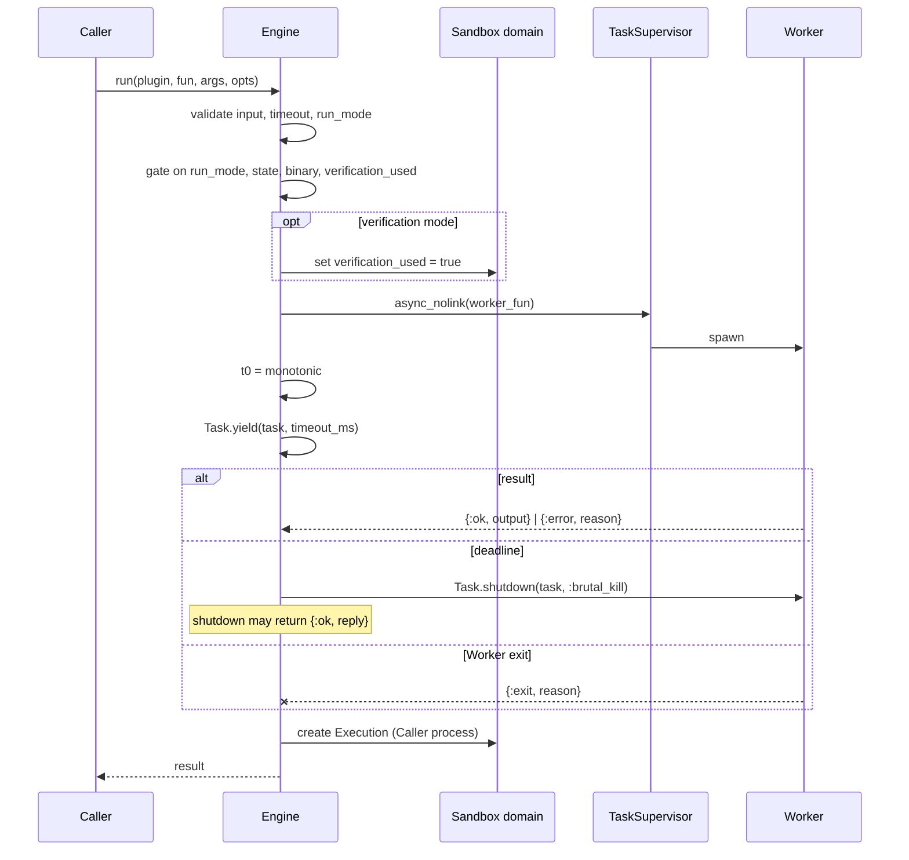

# Design Document

## Overview

The Poltergeist Sandbox (Phase 1 of ChimeraRuntime) stores WebAssembly plugins as Ash resources in SQLite, runs each plugin in an isolated, deadline-bound BEAM process using Wasmex with WASI disabled, and records every run as an audited `Execution`.

Main decisions:

- **Ash domain `ChimeraRuntime.Sandbox`** with exactly three resources: `Plugin` (AshStateMachine, lifecycle `:draft -> :compiling -> :active`, plus `:quarantined`), `Execution` (AshPaperTrail history) and the generated `Execution.Version`. All use `AshSqlite.DataLayer`.
- **No separate Audit domain.** `ash_paper_trail` 0.8.1 always places the generated `Execution.Version` resource in the source resource's domain, so it is registered in `ChimeraRuntime.Sandbox` (R1.8, R1.9, D4).
- **Fuel metering plus BEAM deadline.** Every run uses a Wasmex engine with `consume_fuel: true` and a finite fuel budget set on the store before the call, so Wasmtime itself halts runaway code. The BEAM `Task.yield`/`brutal_kill` deadline stays the authoritative backstop (R7.8 to R7.13).
- **`ChimeraRuntime.Runner.Engine`** is a plain module, not a GenServer. All coordination runs in the Caller process. The Caller validates, gates, consumes the verification one-shot, starts one unlinked Worker, waits with `Task.yield`, kills on timeout, persists the Execution, and returns `{:ok, output} | {:error, reason}`.
- **Worker** is started with `Task.Supervisor.async_nolink/2` under `ChimeraRuntime.Runner.TaskSupervisor`. This gives monitor-based results, so a Worker crash arrives as `{:exit, reason}` from `Task.yield` and never as a link signal to the Caller.
- **Wasmex with `wasi: false`** and an empty imports map. No WASI, no host functions. Any declared import fails instantiation.
- **Verification run (Gravedigger)** is a one-shot `:verification` Run_Mode, allowed only while a Plugin is `:compiling` and `verification_used` is false.

### Research findings that shape the design

- Ash AshSqlite requires the Repo to `use AshSqlite.Repo` (wrapping `Ecto.Adapters.SQLite3`). The existing `ChimeraRuntime.Repo` uses `Ecto.Repo` directly. The design converts it to `use AshSqlite.Repo, otp_app: :chimera_runtime` and adds `installed_extensions/0` and `min_pg_version`-free SQLite equivalents as the generator emits. This is a source change in `repo.ex`, not a `mix.exs` change.
- Ash usage rules (`deps/ash/usage-rules`) mandate: define actions explicitly, use code interfaces on the domain, and use `mix ash.codegen` for migrations. This design follows them. Ash is configured with `default_actions_require_atomic?: true` in `config/config.exs`, so custom update actions with `change` functions must be atomic or declare `require_atomic? false`.
- `Task.Supervisor.async_nolink/3` plus `Task.yield/2` and `Task.shutdown(task, :brutal_kill)` is the documented OTP pattern for containing failing tasks. `Task.shutdown/2` returns `{:ok, reply}` if the task replied during shutdown, `{:exit, reason}` if it died, and `nil` if killed (covers Requirement 7.7).
- Wasmex 0.16.0 API, verified from `deps/wasmex` (see "Wasmex 0.16.0 option-shape verification"): `Wasmex.start_link/1` takes a map with `:bytes`, `:imports`, `:links`, `:wasi`, `:name`, or a prebuilt `:store` plus `:module`. Without `:store` it builds a store on the default engine, which has fuel disabled. Fuel therefore requires building the engine and store ourselves: `Wasmex.Engine.new(%Wasmex.EngineConfig{consume_fuel: true})`, `Wasmex.Store.new(nil, engine)`, `Wasmex.StoreOrCaller.set_fuel(store, n)`, `Wasmex.Module.compile(store, bytes)`, then `Wasmex.start_link(%{store: store, module: module, imports: %{}})`. A new store starts with 0 fuel and traps immediately, so `set_fuel` is mandatory before every call.
- Fuel and epochs: with `consume_fuel: true`, exhausted fuel raises a Wasm trap, so an infinite loop is stopped inside Wasmtime instead of spinning on a native thread. The native engine in 0.16.0 always enables epoch interruption (`config.epoch_interruption(true)` in `native/wasmex/src/engine.rs`) with a 10 ms ticker, but `Wasmex.EngineConfig` exposes no epoch option. Epoch interruption is therefore not a configurable fallback; it is inherent and the Engine passes nothing for it. Because fuel is supported, the fallback clause R7.9 is not triggered.
- The BEAM deadline still applies to every run: fuel bounds instruction count, not wall-clock time (a host call or slow instruction mix could outlast the deadline), so `Task.yield`/`Task.shutdown(:brutal_kill)` remains authoritative (R7.13). The Wasmex GenServer is started inside the Worker and linked to it, so killing the Worker terminates it too.
- Dependencies: `ash_sqlite` and `ash_paper_trail` are approved but NOT added by this document. At implementation the versions are pinned with `"== x.y.z"`, then `mix usage_rules.sync --yes` runs. No other `mix.exs` entry changes (Requirement 12).

## Architecture

```mermaid
flowchart TD
    Caller[Caller process] -->|run/4| Engine[Runner.Engine]
    Engine -->|validate + gate| Gate{Gate}
    Gate -->|reject| ErrNoWorker["{:error, reason}, no Worker, no Execution"]
    Gate -->|verification: set verification_used| Plugin[(Plugin / SQLite)]
    Gate -->|ok| TS[Runner.TaskSupervisor]
    TS -->|async_nolink| Worker[Worker process]
    Worker --> Wasmex[Wasmex wasi: false, imports: %{}]
    Engine -->|Task.yield timeout_ms| Worker
    Engine -->|brutal_kill on deadline| Worker
    Worker -->|EngineConfig consume_fuel + set_fuel| Fuel[Wasmtime fuel budget]
    Fuel -->|out of fuel trap| Worker
    Engine -->|create Execution from Caller| Exec[(Execution, Sandbox domain)]
    Exec -->|PaperTrail versions| Audit[(Version resource, Sandbox domain)]
    Engine --> Result["{:ok, output} | {:error, reason}"]
```

### Run sequence



### Supervision tree change

`ChimeraRuntime.Application.start/2` adds `{Task.Supervisor, name: ChimeraRuntime.Runner.TaskSupervisor}` to `children`, placed after `ChimeraRuntime.Repo` and before `ChimeraRuntimeWeb.Endpoint`, so it is up before the Engine accepts a run (Requirement 6.3). Strategy stays `:one_for_one`.

### Configuration changes

- `config/config.exs`: add `ash_domains: [ChimeraRuntime.Sandbox]` under `config :chimera_runtime`, so the domain resolves at boot (R1.3). Also add `config :ash_paper_trail` only if the pinned version needs it.
- `lib/chimera_runtime/repo.ex`: switch to `use AshSqlite.Repo`.
- Migrations are generated with `mix ash.codegen` and applied with `mix ash.migrate` / existing `Ecto.Migrator`. Resource snapshots go to `priv/resource_snapshots`. The generated migrations create three tables, all in the Sandbox domain: `plugins`, `executions` and `executions_versions`, each with a column per persisted attribute (R1.5). A failing migration halts the run and rolls back its own table creation, since each migration runs in a transaction (R1.6).
- Fuel budget: a single application-config value `config :chimera_runtime, ChimeraRuntime.Runner.Engine, fuel_budget: 10_000_000` (finite, positive integer; tests override it with a small value). This is application config, not a dependency change.

## Components and Interfaces

### File layout

```
lib/chimera_runtime/sandbox.ex                     # Ash domain
lib/chimera_runtime/sandbox/plugin.ex              # Plugin resource
lib/chimera_runtime/sandbox/execution.ex           # Execution resource
lib/chimera_runtime/sandbox/validations/error_reason_matches_status.ex
lib/chimera_runtime/sandbox/changes/require_wasm_binary.ex   # optional, or inline validation
lib/chimera_runtime/runner/engine.ex               # isolation engine
lib/chimera_runtime/runner/worker.ex               # pure Wasmex invocation, runs inside Worker
test/support/wasm_fixtures.ex                      # WAT/bytes fixtures
test/chimera_runtime/runner/engine_property_test.exs
test/chimera_runtime/runner/engine_test.exs
test/chimera_runtime/sandbox/plugin_test.exs
test/chimera_runtime/sandbox/execution_test.exs
```

### Sandbox domain

```elixir
defmodule ChimeraRuntime.Sandbox do
  use Ash.Domain

  resources do
    resource ChimeraRuntime.Sandbox.Plugin do
      define :create_plugin, action: :create
      define :get_plugin, action: :read, get_by: [:id]
      define :compile_plugin, action: :compile
      define :activate_plugin, action: :activate
      define :quarantine_plugin, action: :quarantine
      define :mark_verification_used, action: :mark_verification_used
    end

    resource ChimeraRuntime.Sandbox.Execution do
      define :create_execution, action: :create
      define :list_executions, action: :read
    end

    resource ChimeraRuntime.Sandbox.Execution.Version do
      define :list_execution_versions, action: :read
    end
  end
end
```

Exactly three resources are registered (Requirements 1.2, 1.8): Plugin, Execution, and the AshPaperTrail-generated `ChimeraRuntime.Sandbox.Execution.Version`. `ash_paper_trail` 0.8.1 always places the Version resource in its source resource's domain, so there is no separate Audit domain (R1.9, D4). Version rows are read through the `list_execution_versions` code interface.


### Plugin resource

- Data layer: `AshSqlite.DataLayer`, table `"plugins"`, repo `ChimeraRuntime.Repo`.
- Extension: `AshStateMachine`.

```elixir
state_machine do
  initial_states [:draft]
  default_initial_state :draft

  transitions do
    transition :compile,    from: :draft,                           to: :compiling
    transition :activate,   from: :compiling,                       to: :active
    transition :quarantine, from: [:draft, :compiling, :active],    to: :quarantined
  end
end
```

Actions:

| Action | Type | Notes |
| --- | --- | --- |
| `:create` | create | accepts `name, source_code, wasm_binary, timeout_ms`; state defaults to `:draft` |
| `:update` | update | accepts the same fields, not `state` or `verification_used` |
| `:compile` | update | `change transition_state(:compiling)` |
| `:activate` | update | validation: `wasm_binary` non-nil and `byte_size > 0`; `change transition_state(:active)`; ignores `verification_used` |
| `:quarantine` | update | `change transition_state(:quarantined)` |
| `:mark_verification_used` | update | internal; sets `verification_used` true. Does not touch state |

Attributes and constraints:

| Attribute | Type | Constraints |
| --- | --- | --- |
| `id` | uuid_primary_key | |
| `name` | string | `allow_nil? false`, `constraints min_length: 1, max_length: 255, allow_empty?: false` |
| `source_code` | string | optional, validated `byte_size <= 1_048_576` |
| `wasm_binary` | binary | optional, validated `byte_size <= 10_485_760` |
| `timeout_ms` | integer | default 500, `constraints min: 1, max: 600_000` |
| `verification_used` | boolean | default false, `allow_nil? false`, not public-writable |
| `state` | atom | managed by AshStateMachine |

Identity: `identity :unique_name, [:name]` (case-sensitive). SQLite default string comparison is case-sensitive via `=`, so no `COLLATE NOCASE` is added. Error message is "has already been taken".

Aggregates and calculations (Requirement 5):

```elixir
aggregates do
  count :total_runs, :executions
  avg   :avg_duration_ms, :executions, :duration_ms
  count :failed_runs, :executions do
    filter expr(status in [:timeout, :error])
  end
end

calculations do
  calculate :failure_rate, :float,
    expr(if total_runs == 0, do: 0.0, else: failed_runs / total_runs)
end
```

`failed_runs` is an internal aggregate used by `failure_rate`. `failure_rate` divides as float, so SQLite integer division is avoided by casting (`type(failed_runs, :float)`). `avg` over zero rows or all-nil durations is `nil` (SQL `AVG` ignores NULL). Executions of both run modes are counted, since the aggregates carry no `run_mode` filter (5.9). Aggregates are computed in SQL on read, which satisfies 5.8 without cached counters.

Atomicity: state transitions use `transition_state` which is atomic-compatible. `:activate`'s validation uses an `expr`-based `attribute_does_not_equal`/ `compare` or declares `require_atomic? false`, with a function validation that reads `changeset.data.wasm_binary`. Decision: use `require_atomic? false` on `:activate` only, with a validation module reading the data, since the binary is not changed by that action.

Failure atomicity (3.8): Ash runs actions in a transaction, and `transaction_rollback_on_error?: true` is already set, so a failed action leaves state unchanged. The invalid-transition error from AshStateMachine (`AshStateMachine.Errors.NoMatchingTransition`) carries the old state and the action (3.6).

### Execution resource

- Data layer: `AshSqlite.DataLayer`, table `"executions"`.
- Extension: `AshPaperTrail.Resource` with `change_tracking_mode :changes_only`, `store_action_name? true`. PaperTrail generates a `ChimeraRuntime.Sandbox.Execution.Version` resource in the same (Sandbox) domain (see Decision D4).

Attributes:

| Attribute | Type | Constraints |
| --- | --- | --- |
| `id` | uuid_primary_key | |
| `input_json` | map | public |
| `output_json` | map | nullable |
| `duration_ms` | integer | `allow_nil? false`, `min: 0, max: 2_147_483_647` |
| `status` | atom | `constraints one_of: [:success, :timeout, :error]`, `allow_nil? false` |
| `error_reason` | string | `max_length: 2000` |
| `run_mode` | atom | `one_of: [:standard, :verification]`, default `:standard`, `allow_nil? false` |
| `plugin_id` | uuid | from `belongs_to :plugin, Plugin, allow_nil? false` |

Validation `ErrorReasonMatchesStatus` (module `ChimeraRuntime.Sandbox.Validations.ErrorReasonMatchesStatus`):

- `status == :success` requires `error_reason == nil`.
- `status in [:timeout, :error]` requires `error_reason` with `String.trim(error_reason) != ""`.
- Failure adds an error on `:error_reason`.

The validation runs on both create and update (`on: [:create, :update]`). The Execution has `:create` and `:update` actions with `accept` lists. The update action exists so 4.6/4.8 and 4.10 apply to updates. Because validation errors abort the action before commit, no version row is written (4.13).

Integer overflow: `duration_ms` is capped at 2_147_483_647 by the attribute constraint, and the Engine clamps measured durations with `min(duration, 2_147_483_647)`.

A `belongs_to` referencing a non-existent Plugin: with `AshSqlite` `references do reference :plugin, on_delete: :restrict end`, and Ash relationship validation (`validate_destination?` default behavior via the foreign key constraint) the create returns an error on `plugin_id` (4.2). A missing `plugin_id` fails `allow_nil? false`.

### Engine

```elixir
defmodule ChimeraRuntime.Runner.Engine do
  @type run_mode :: :standard | :verification
  @type result :: {:ok, [term()]} | {:error, atom() | tuple()}

  @spec run(term(), term(), term(), keyword() | term()) :: result()
  def run(plugin, function_name, args, opts \\ [])
end
```

`run/4` is total: it accepts any terms and always returns exactly one tuple (10.6). Its body is split into pure stages composed with `with`:

1. `validate_input/4`: plugin is `%Plugin{}`; `function_name` is a binary of 1..255 bytes; `args` is a list of 0..64 elements (`length/1` guarded on proper lists; improper lists are rejected through `is_list` plus a safe length check); `run_mode` from `Keyword.get(opts, :run_mode, :standard)`, with non-keyword `opts` rejected. Failure returns `{:error, {:invalid_input, detail}}`.
2. `validate_timeout/1`: `timeout_ms` is an integer in `1..600_000`, else `{:error, :invalid_timeout}`.
3. `gate/2`: pure function of `{run_mode, state, wasm_binary, verification_used}`, defined below.
4. `consume_verification/2`: for `:verification`, calls `Sandbox.mark_verification_used/1` from the Caller before the Worker starts. Failure returns `{:error, :verification_marker_failed}`.
5. `execute/…`: starts the Worker, yields, shuts down, collects `{result, duration_ms}`.
6. `record_execution/…`: persists from the Caller, logs on failure, never alters the result.

The entire body is wrapped in `try/rescue/catch` (`kind, value`) that maps to `{:error, {:runtime_failure, …}}` so no raise, exit, or throw reaches the Caller (10.5). The catch wraps only Caller-side code. Worker failures are already converted by `Task.yield`.

#### Gate truth table (pure function `gate/1`)

Inputs: `run_mode`, `state`, `has_binary?` (non-nil `wasm_binary`), `verification_used`.

| run_mode | state | has_binary? | verification_used | result |
| --- | --- | --- | --- | --- |
| `:standard` | `:active` | yes | any | proceed |
| `:standard` | `:active` | no | any | `{:error, :missing_binary}` |
| `:standard` | not `:active` | any | any | `{:error, :plugin_not_active}` |
| `:verification` | not `:compiling` | any | any | `{:error, :plugin_not_active}` |
| `:verification` | `:compiling` | any | true | `{:error, :verification_already_used}` |
| `:verification` | `:compiling` | no | false | `{:error, :missing_binary}` |
| `:verification` | `:compiling` | yes | false | proceed (consume one-shot) |

Row order encodes precedence. State is checked before the binary (8.8), and the one-shot check precedes the binary check for `:compiling`/`used` plugins (8.10: "verification_used true then `:verification_already_used`").

Open point: when `run_mode` is `:verification`, state `:compiling`, `verification_used` is true and binary is nil, the requirements give 8.10 (already used) and 8.7 (missing binary) both as applicable. The design resolves it in favor of `:verification_already_used`, since the one-shot status is the more specific cause. Flagged for review.

Nil binary and empty binary: `has_binary?` means `is_binary(wasm_binary)`. An empty binary proceeds to the Worker and fails in Wasmex as a compile failure (consistent with property 11.2, which generates 0-byte inputs and expects `{:error, _}`).

Plugin freshness: the Engine uses the struct passed in. For `:verification` it must see current `verification_used`; callers pass a fresh record. `consume_verification/2` additionally reloads through `Ash.get` with an atomic conditional update (`:mark_verification_used` has `filter expr(verification_used == false)`) so two concurrent verification runs cannot both consume the one-shot. If the filter matches nothing, the Engine returns `:verification_already_used`.

#### Wasmex 0.16.0 option-shape verification (precondition for the Engine)

Before writing `Worker`, the implementer reads `deps/wasmex` (version 0.16.0) and confirms every option the Engine will pass (R6.10 to R6.12). The Engine passes only confirmed options. Results from reading the source for this design:

| Item | Confirmed shape (0.16.0) | Source |
| --- | --- | --- |
| `Wasmex.start_link/1` | map with `:bytes`, `:imports` (default `%{}`), `:links`, `:wasi` (`true`, `false`, or `%Wasmex.Wasi.WasiOptions{}`; default `false`), `:name`, or `:store` + `:module`. `:module` without `:store` returns `{:error, :must_specify_store_used_to_compile_module}`. Without `:store` it uses the default engine (no fuel). Internally pattern-matches `{:ok, store}` and `{:ok, module}`, so a failed compile raises a `MatchError` in the caller | `lib/wasmex.ex` |
| `Wasmex.Engine.new/1` | `%Wasmex.EngineConfig{}` to `{:ok, engine} \| {:error, binary}` | `lib/wasmex/engine.ex` |
| `Wasmex.EngineConfig` | struct fields `consume_fuel`, `cranelift_opt_level`, `wasm_backtrace_details`, `memory64`, `wasm_component_model`, `debug_info`. No epoch field | `lib/wasmex/engine_config.ex` |
| `Wasmex.Store.new/2` | `(store_limits \\ nil, engine \\ nil)` to `{:ok, StoreOrCaller}` | `lib/wasmex/store.ex` |
| `Wasmex.StoreOrCaller.set_fuel/2` | `(store, fuel)` to `:ok \| {:error, binary}`; errors when fuel is not enabled; a new store starts at 0 fuel | `lib/wasmex/store_or_caller.ex` |
| `Wasmex.StoreOrCaller.get_fuel/1` | `{:ok, remaining}`; used by the example test asserting a finite budget (R11.18) | same |
| `Wasmex.Module.compile/2` | `(store, bytes)` to `{:ok, module} \| {:error, reason}` | `lib/wasmex/module.ex` |
| WASI | `wasi: false` (the default) builds the store through `Wasmex.Store.new/0`. `Wasmex.Wasi.WasiOptions` and `Wasmex.Pipe` exist but are NOT used: the Engine never builds a WASI store or pipes | `lib/wasmex.ex`, `lib/wasmex/wasi/`, `lib/wasmex/pipe.ex` |
| Epoch interruption | always enabled natively (10 ms ticker); no Elixir option. The Engine passes nothing for it | `native/wasmex/src/engine.rs`, `runtime.rs` |

Consequences for the Worker:

- Because `Wasmex.start_link/1` matches `{:ok, _}` on compile, the Worker compiles the module itself with `Wasmex.Module.compile/2` and passes `:store` plus `:module`, so a compile error becomes a normal `{:error, _}` instead of a `MatchError` (also wrapped in the Worker `try/rescue` as a safeguard).
- A store built with `Store.new/2` (not `new_wasi`) is the WASI-disabled store.
- Not yet confirmed from source: the exact error text for fuel exhaustion (Wasmtime's trap message). The Worker matches the `{:error, msg}` from `call_function` with `String.contains?(String.downcase(msg), "fuel")`, and the fuel-exhaustion example test (R11.17) pins the real message. If the text does not contain "fuel", the matcher is adjusted to the observed message before the Engine is considered done.
- If any option the design needs turns out not to exist, implementation of that part stops and the gap is reported to the user. `mix.exs` is not touched either way (R6.12).

#### Worker execution

```elixir
task =
  Task.Supervisor.async_nolink(ChimeraRuntime.Runner.TaskSupervisor, fn ->
    ChimeraRuntime.Runner.Worker.invoke(binary, function_name, args)
  end)

t0 = System.monotonic_time(:millisecond)

outcome =
  case Task.yield(task, timeout_ms) do
    {:ok, result}     -> {:finished, result}
    {:exit, reason}   -> {:crashed, reason}
    nil ->
      case Task.shutdown(task, :brutal_kill) do
        {:ok, result}   -> {:finished, result}      # completed during shutdown (7.7)
        {:exit, reason} -> {:crashed, reason}
        nil             -> :timeout
      end
  end

duration_ms = System.monotonic_time(:millisecond) - t0
```

Mailbox hygiene (8.5): `async_nolink` monitors the task. `Task.yield` returning `{:exit, _}` and `Task.shutdown` both demonitor with flush, so no `:DOWN` or reply messages remain. Neither `Task.yield/2` nor `Task.shutdown/2` links, so no `:EXIT` is generated; the Caller never traps exits itself (that satisfies "trap the exit" via monitor semantics rather than `trap_exit`, which would change Caller process flags).

`Worker.invoke/3` (runs inside the Worker):

```elixir
def invoke(binary, function_name, args) do
  with {:ok, pid} <- start_instance(binary),
       :ok <- check_export(pid, function_name),
       {:ok, output} <- call(pid, function_name, args) do
    {:ok, output}
  end
end
```

- `start_instance/1`, using only options confirmed in the verification table:

  ```elixir
  {:ok, engine} = Wasmex.Engine.new(%Wasmex.EngineConfig{consume_fuel: true})
  {:ok, store}  = Wasmex.Store.new(nil, engine)          # no WASI
  :ok           = Wasmex.StoreOrCaller.set_fuel(store, fuel_budget)
  {:ok, module} = Wasmex.Module.compile(store, binary)
  Wasmex.start_link(%{store: store, module: module, imports: %{}})
  ```

  Each step is matched in a `with`, and `set_fuel` runs for every run before any exported function is called (R7.8). `fuel_budget` is a positive integer from config. A `{:error, _}` or an exit from start (Wasmex linked start failure) maps to `{:error, {:compile_error, msg}}` or `{:instantiation_error, msg}`. An unresolved import message maps to `{:error, {:unsatisfied_import, msg}}`. Because `start_link` links to the Worker, a start failure exit is caught inside the Worker via `Process.flag(:trap_exit, true)` set at the top of `invoke/3`; this flag lives on the Worker, never the Caller.
- `check_export/2`: uses `Wasmex.function_exports/2` (or the module's exports) and returns `{:error, {:missing_export, function_name}}` if absent (8.3).
- `call/3`: `Wasmex.call_function/3`. An `{:error, msg}` whose message indicates fuel exhaustion maps to `{:error, {:fuel_exhausted, msg}}` (R7.10); other trap messages map to `{:error, {:trap, msg}}`; remaining errors map to `{:error, {:call_error, msg}}`. The fuel check comes first, because fuel exhaustion also surfaces as a trap. Partial results are dropped because only the final tuple is returned (8.4).
- Wasm values are returned as the list produced by Wasmex (`[]` when none, 10.2).

The Worker returns its result as a plain term. Mapping of the Worker outcome to Engine results:

| Outcome | Engine result | Execution |
| --- | --- | --- |
| `{:finished, {:ok, out}}` | `{:ok, out}` | `:success` |
| `{:finished, {:error, {:fuel_exhausted, _} = reason}}` | `{:error, reason}` | `:timeout` (R7.11, R9.10) |
| `{:finished, {:error, reason}}` | `{:error, reason}` | `:error` |
| `{:crashed, exit_reason}` | `{:error, {:worker_exit, exit_reason}}` | `:error` |
| `:timeout` | `{:error, :timeout}` | `:timeout` |

Wasmex process cleanup: the Wasmex GenServer is linked to the Worker. When the Worker exits (normal, crash, or kill), linked processes receive the exit signal and terminate (non-trapping Wasmex GenServer dies with the Worker; if it traps exits, GenServer handles a parent exit by terminating). To make normal completion deterministic, `invoke/3` calls `GenServer.stop(pid)` in an `after` block before returning (6.4).

#### Execution persistence

`record_execution/…` runs in the Caller after the outcome is observed:

```elixir
attrs = %{
  plugin_id: plugin.id,
  input_json: %{"function" => function_name, "args" => encode_args(args)},
  output_json: output_map_or_nil,
  duration_ms: min(duration_ms, 2_147_483_647),
  status: status,
  error_reason: reason_string_or_nil,
  run_mode: run_mode
}
```

- `input_json` and `output_json` are maps. Lists of Wasm values are wrapped as `%{"values" => list}`; arguments are stored as `%{"function" => name, "args" => list}`. Floats `NaN`/infinity cannot appear in Wasm-to-JSON conversion; the encoder converts non-JSON-safe floats to strings via `inspect/1`.
- `error_reason` is built by `format_reason/1`: `inspect(reason, limit: 50, printable_limit: 500)`, trimmed, truncated to 1,000 characters, guaranteed non-empty (falls back to `"unknown error"`). The deadline reason is `"deadline of #{timeout_ms}ms exceeded"`, and the fuel reason is `"fuel exhausted: " <> msg`, both non-empty and within the 1,000 character cap (R9.2, R9.10).
- On `{:error, _}` from `Sandbox.create_execution/1`, the Engine calls `Logger.error("failed to persist execution", plugin_id: …, reason: …)` exactly once, does not retry, and returns the original result (9.6).
- If a failure occurs before the Worker started (validation, gate, marker), no Execution is created (9.8).

Persistence is performed in the Caller, and a Worker has no reference to the Repo (9.4).

#### Time and deadline guarantees

- `Task.yield(task, timeout_ms)` returns within `timeout_ms` plus scheduling jitter. `Task.shutdown(task, :brutal_kill)` is synchronous but fast. Total overhead is expected to be well under 100 ms (7.5), apart from Execution persistence, which happens after the time-critical path. Requirement 11.5 measures to the Engine's return, which includes persistence. SQLite writes are single-digit milliseconds, so this fits in the 100 ms margin. If this proves flaky the persistence can be moved ahead of nothing; the risk is documented in Error Handling.
- `duration_ms` uses `System.monotonic_time(:millisecond)` between Worker start and outcome observation (9.5).

## Data Models

### plugins

| Column | Type | Null | Notes |
| --- | --- | --- | --- |
| id | uuid | no | PK |
| name | text | no | unique index |
| source_code | text | yes | |
| wasm_binary | blob | yes | |
| timeout_ms | integer | no | default 500 |
| verification_used | boolean | no | default false |
| state | text | no | default `draft` |
| inserted_at / updated_at | utc_datetime_usec | no | |

### executions

| Column | Type | Null | Notes |
| --- | --- | --- | --- |
| id | uuid | no | PK |
| plugin_id | uuid | no | FK to plugins, `on_delete: :restrict` |
| input_json | map (text/JSON) | yes | |
| output_json | map (text/JSON) | yes | |
| duration_ms | integer | no | |
| status | text | no | |
| error_reason | text | yes | |
| run_mode | text | no | default `standard` |
| inserted_at / updated_at | utc_datetime_usec | no | |

### executions_versions (Sandbox domain)

AshPaperTrail adds an `executions_versions` table owned by the `ChimeraRuntime.Sandbox` domain (version id, `version_source_id`, `changes` map, `version_action_name`, `version_action_type`, timestamps).

### Decisions and rationale

- **D1: Engine as module, not GenServer.** The Caller owns persistence and the one-shot marker, which the requirements demand (8.11, 9.4). A GenServer would serialize runs and add a failure point.
- **D2: `async_nolink` plus `yield`/`shutdown`.** Provides unlinked processes with mailbox cleanup, and handles the shutdown race (7.7) in one code path.
- **D3: Derived `failure_rate` as a calculation over aggregates.** It stays consistent with executions on every read (5.8) without write-time bookkeeping.
- **D4: PaperTrail version resource lives in the `ChimeraRuntime.Sandbox` domain. REVISED.** `ash_paper_trail` 0.8.1 has no option to route the generated Version resource to another domain; it always uses the source resource's domain. The earlier plan for a separate `ChimeraRuntime.Audit` domain was dropped. Sandbox registers Plugin, Execution and `Execution.Version`, and only Sandbox is in `:ash_domains`.
- **D7: Fuel metering with the BEAM deadline as backstop.** Fuel stops runaway Wasm inside Wasmtime so no native thread keeps spinning; the deadline still covers wall-clock limits. Fuel exhaustion is recorded as `:timeout`, since it is a resource-limit stop rather than a module bug.
- **D5: Verification is consumed before the Worker starts**, so a crash, timeout, or Engine failure cannot re-arm it (8.11, 8.13).
- **D6: Repo conversion to `AshSqlite.Repo`** is required by the data layer and is the only existing non-`mix.exs` file whose behavior changes.

## Correctness Properties

*A property is a characteristic or behavior that should hold true across all valid executions of a system-essentially, a formal statement about what the system should do. Properties serve as the bridge between human-readable specifications and machine-verifiable correctness guarantees.*

**Reflection on redundancy:**

From the prework, candidate properties were merged to remove redundancy:

- Requirements 11.2, 11.3, 11.4 (three byte-array generators) are all "invalid bytes produce an error". They remain separate properties only because the requirements ask for three generators, but they share one assertion body (Property 1), parameterized by generator.
- Caller liveness (6.2, 6.6, 8.1, 8.5, 11.6), supervisor cleanliness (6.4-6.6, 11.7), and mailbox hygiene (8.5) merge into one containment property (Property 2).
- Execution count rules (9.1, 9.8, 11.8, 11.9) and field rules (9.2, 9.3, 9.9) merge into Property 4 and Property 5.
- Validation properties for `timeout_ms` (2.4, 2.5, 2.8) and Engine timeout validation (7.2) stay separate: one is on the Ash resource, one on the Engine.
- Execution validity properties 4.11, 4.12, 4.13 merge into one iff-style property (Property 8).
- 10.6 ("exactly one result tuple for any input") subsumes 10.4 and 10.5 and is a single property.

### Property 1: Invalid Wasm bytes are rejected without harm

*For any* byte array of 0 to 4096 bytes (arbitrary, with the `\0asm` header followed by arbitrary bytes, or with a first four bytes differing from `\0asm`), running an active Plugin holding that array as `wasm_binary` returns `{:error, reason}`, and the Caller process is alive afterward.

**Validates: Requirements 11.2, 11.3, 11.4, 8.2, 10.3**

### Property 2: Failures are contained and leave no residue

*For any* Rogue_Module input run in `:standard` mode on an active Plugin, after `Engine.run/4` returns, the Caller is alive, the Caller mailbox contains no `:DOWN`, `:EXIT`, or task-reply messages, and `Task.Supervisor.children(ChimeraRuntime.Runner.TaskSupervisor)` is empty within 100 ms.

**Validates: Requirements 6.2, 6.4, 6.5, 6.6, 8.1, 8.5, 11.6, 11.7**

### Property 3: Infinite loops hit the deadline and leave no spinning instance

*For any* `timeout_ms` in 10..500, running the infinite-loop Wasm module with that `timeout_ms` returns `{:error, :timeout}` and the elapsed time from call to return is at most `timeout_ms + 100` ms; and a follow-up Engine run of a valid Plugin immediately afterward returns `{:ok, output}` within 500 ms. (The configured fuel budget is large enough that the BEAM deadline fires first, so the property exercises the backstop. Fuel exhaustion itself is covered by the example test for R11.17.)

**Validates: Requirements 7.1, 7.3, 7.4, 7.5, 7.12, 7.13, 11.5, 11.16**

### Property 4: Executions are recorded exactly when a Worker started

*For any* Rogue_Module input and plugin configuration, the number of persisted Executions of the Plugin increases by exactly 1 if the Engine started a Worker, and by 0 otherwise.

**Validates: Requirements 9.1, 9.8, 11.8, 11.9**

### Property 5: Recorded Executions are well-formed

*For any* run that started a Worker, the created Execution has `plugin_id` equal to the Plugin id, `run_mode` equal to the run's mode, `duration_ms` a non-negative integer, status `:success` with nil `error_reason` for `{:ok, _}`, status `:timeout` for `{:error, :timeout}` and for `{:error, {:fuel_exhausted, _}}`, status `:error` otherwise, and for non-success statuses an `error_reason` that is a non-empty string of at most 1,000 characters.

**Validates: Requirements 9.1, 9.2, 9.3, 9.7, 9.9, 9.10**

### Property 6: Engine is total

*For any* terms supplied as plugin, function name, arguments, and options (including wrong types, out-of-range lengths, invalid `run_mode`, and invalid `timeout_ms`), `Engine.run/4` returns exactly one of `{:ok, list}` or `{:error, reason}` where `reason` is an atom or a tuple whose first element is an atom, starts no Worker for invalid input, and raises, exits, or throws nothing to the Caller.

**Validates: Requirements 10.1, 10.3, 10.4, 10.5, 10.6, 7.2**

### Property 7: Gate decision matches the truth table

*For any* combination of `run_mode`, Plugin Lifecycle_State, `wasm_binary` presence, and `verification_used`, the gate function returns the result defined by the gate truth table, and zero Workers are started and the Plugin record is unchanged whenever the result is an error.

**Validates: Requirements 8.6, 8.7, 8.8, 8.9, 8.10**

### Property 8: Execution error_reason agrees with status

*For any* Execution attributes, a create or update is accepted if and only if `error_reason` is nil when `status` is `:success`, and contains at least one non-whitespace character when `status` is `:timeout` or `:error`; a rejected change leaves the stored record and its version history unchanged.

**Validates: Requirements 4.11, 4.12, 4.13**

### Property 9: failure_rate is bounded and exact

*For any* sequence of 0 to 50 Executions with mixed statuses attached to a Plugin, `failure_rate` is a float with `0.0 <= failure_rate <= 1.0`, equals 0.0 for the empty sequence, and equals `count(status in [:timeout, :error]) / total_runs` otherwise, with `total_runs` equal to the sequence length.

**Validates: Requirements 5.1, 5.3, 5.4, 5.7, 5.8, 11.10**

### Property 10: Average duration is the mean of non-nil durations

*For any* sequence of Executions of a Plugin, `avg_duration_ms` equals the arithmetic mean of the `duration_ms` values, and is nil for the empty sequence.

**Validates: Requirements 5.2, 5.5**

### Property 11: Invalid transitions are rejected and leave the Plugin unchanged

*For any* Lifecycle_State and any state-changing action not defined for that state, the action returns an error that identifies the current state and the action, and the stored Plugin (state and all other attributes) is unchanged.

**Validates: Requirements 3.6, 3.7, 3.8**

### Property 12: Plugin field validation

*For any* `timeout_ms` integer, a Plugin is accepted if and only if `1 <= timeout_ms <= 600_000`; *for any* `name` string, a Plugin is accepted if and only if its length is 1..255; and a rejected change leaves the stored record unchanged.

**Validates: Requirements 2.1, 2.4, 2.5, 2.7, 2.8**

### Property 13: Execution duration range

*For any* integer `duration_ms`, an Execution is accepted if and only if `0 <= duration_ms <= 2_147_483_647`; non-integers and nil are rejected.

**Validates: Requirements 4.5, 4.6**

### Property 14: Verification is one-shot and non-state-changing

*For any* Plugin in `:compiling` with a valid binary and `verification_used` false, after a `:verification` run of any outcome (success, trap, timeout, or invalid-import failure), `verification_used` is true, the Lifecycle_State is still `:compiling`, and a second `:verification` run returns `{:error, :verification_already_used}` and creates no Execution.

**Validates: Requirements 8.11, 8.13, 3.10, 8.10**

## Error Handling

| Condition | Engine behavior | Execution |
| --- | --- | --- |
| Invalid plugin / name / args / mode | `{:error, {:invalid_input, detail}}` | none |
| Invalid `timeout_ms` | `{:error, :invalid_timeout}` | none |
| State/binary/one-shot gate failure | `:plugin_not_active`, `:missing_binary`, or `:verification_already_used` | none |
| Verification marker persistence failure | `{:error, :verification_marker_failed}` | none |
| Invalid Wasm bytes, unresolved import, instantiation error | `{:error, {:compile_error \| :unsatisfied_import \| :instantiation_error, msg}}` | `:error` |
| Missing export | `{:error, {:missing_export, name}}` | `:error` |
| Wasm trap | `{:error, {:trap, msg}}`, partial results dropped | `:error` |
| Worker crash or kill | `{:error, {:worker_exit, reason}}` | `:error` |
| Fuel exhausted | `{:error, {:fuel_exhausted, msg}}` | `:timeout` |
| Deadline exceeded | `{:error, :timeout}` after `brutal_kill` | `:timeout` |
| Worker finished during shutdown | the Worker result is returned instead of timeout | per result |
| Unexpected raise/exit/throw in Caller-side Engine code | `{:error, {:runtime_failure, detail}}` | none if before Worker start |
| Execution persistence failure | one `Logger.error`, no retry, original result returned | none |

Known risks:

- **Uninterruptible NIF execution. RESOLVED by fuel metering.** A Wasm infinite loop could outlive its killed BEAM process. Every run now uses an engine with `consume_fuel: true` and a finite budget set with `StoreOrCaller.set_fuel/2`, so Wasmtime traps the loop on its own and no instance is left spinning (R7.8, R7.12). Fuel is available in Wasmex 0.16.0, so the epoch fallback (R7.9) is not needed; the native engine also has epoch interruption always on, with no Elixir option. The BEAM deadline remains the authoritative backstop (R7.13): it covers wall-clock limits that fuel does not. Residual risk: a budget set too high delays the stop until the deadline, so the deadline kills the Worker first. In that case the loop is bounded by the Worker teardown dropping the store. The follow-up valid run in Property 3 detects any instance that keeps spinning. If Property 3 ever fails on that check, the fuel budget is lowered rather than the requirement relaxed.
- **Persistence time inside the deadline margin** (7.5/11.5). Mitigated by performing persistence after measuring and by SQLite's low write latency.
- **Concurrent SQLite writers** can raise `database is busy`. A failed Execution write is logged and not retried per requirement 9.6.
- **`require_atomic? false` on `:activate`** is used deliberately (see Plugin resource).

## Testing Strategy

Dual approach: property tests for the Engine, gate, validations, and aggregates; example-based tests for state transitions, fixtures, and wiring.

### Property-based tests

- Library: `StreamData` with `ExUnitProperties`, already in `mix.exs` (`{:stream_data, "~> 1.4"}`). Nothing is implemented from scratch.
- Minimum 100 iterations per property via `max_runs: 100`; Property 3 (infinite loop) uses `max_runs: 20`, matching Requirement 11.13. Properties using real Wasm and the DB should be kept small (shrinking disabled with `max_shrinking_steps: 0` for the slow ones).
- Each test carries a tag comment: `# Feature: poltergeist-sandbox, Property N: <title>`.
- Each correctness property is implemented by a single property test.
- The gate (Property 7) is tested as a pure function, `Engine.gate/1` (public, `@doc false`) to avoid DB cost, and as one integration check for "no Worker started".
- Property 8, 12, 13, 9, 10 run through the Sandbox domain against SQLite using `Ecto.Adapters.SQL.Sandbox` (already configured in `config/test.exs`). Because Workers do not touch the Repo, the sandbox sharing mode is only needed for Caller-side persistence; tests run `async: false`.
- Generators: `wasm_bytes/0` (binary 0..4096), `magic_prefixed_bytes/0` (`<<0, "asm">> <> binary(0..4096)`), `non_magic_bytes/0` (filtered so the first four bytes differ from `\0asm`), `timeout_ms/0` (`integer(10..500)`), `execution_sequence/0` (`list_of(execution_attrs, max_length: 50)`), and `any_term/0` (`StreamData.term()`) for totality.
- Process checks: capture `Task.Supervisor.children/1` after a short polling loop up to 100 ms.

### Example-based unit tests

- Valid module `add(i32, i32) -> i32` (WAT compiled to bytes in `test/support/wasm_fixtures.ex`) returns `{:ok, [expected]}` (11.11). Wasm text compilation must not add a dependency: fixtures are checked-in byte literals (hand-assembled binaries), not generated from WAT at test time.
- Fuel exhaustion (R11.17): with the fuel budget overridden to a small value, the `infinite_loop` fixture returns `{:error, {:fuel_exhausted, _}}` quickly (well before the deadline) and creates one Execution with status `:timeout`. This test also pins the real Wasmtime out-of-fuel message used by the matcher.
- Finite fuel (R11.18): after a run, the store's `StoreOrCaller.get_fuel/1` is finite and at most the configured budget. Implemented through a test seam that exposes the store built by the Worker (for example by calling `Worker.build_store/0` directly).
- Domain registration (R11.19): `ChimeraRuntime.Sandbox.Execution.Version` is in `Ash.Domain.Info.resources(ChimeraRuntime.Sandbox)` alongside Plugin and Execution, `ChimeraRuntime.Audit` is not defined, and creating one Execution creates exactly one Version row.
- Follow-up run (R11.16) is asserted inside Property 3, not as a separate example.
- Fixtures: `add`, `infinite_loop`, `trap_unreachable`, `divide_by_zero`, `module_with_import`, and `no_results`.
- Missing export, trap, and unsatisfied import examples (8.3, 8.4, 6.9).
- All valid state transitions and at least one test per invalid transition, with state unchanged (11.12).
- Verification flows: first run returns `{:ok, output}` and creates one `:verification` Execution, second returns `:verification_already_used` with no Execution, `:standard` on `:compiling` returns `:plugin_not_active`, `:verification` on `:draft`, `:active`, and `:quarantined` returns `:plugin_not_active`, and `activate` still succeeds after the Verification_Run (11.14, 11.15).
- Persistence failure: a stubbed `create_execution` failure logs once (via `ExUnit.CaptureLog`) and returns the run result unchanged. Implemented by injecting the persist function through an application-env hook (`:chimera_runtime, :execution_recorder`), defaulting to the Sandbox code interface.
- Shutdown race (7.7): the wait/shutdown stage is a small private function with a test seam taking the task result; a unit test covers the `{:ok, result}` branch of `Task.shutdown`.
- Plugin uniqueness, defaults, and size limits (2.2, 2.3, 2.6, 2.9).
- PaperTrail: one version row per create/update (4.10), none for rejected changes (4.13).

### Smoke and integration tests

- Application boots with `ChimeraRuntime.Sandbox` in `:ash_domains` and the TaskSupervisor registered (1.3, 6.3).
- Migrations run against an empty database and create the plugins, executions, and executions_versions tables with a column per persisted attribute (1.5); a record survives a Repo restart (1.7).
- Engine source uses `wasi: false` and an empty import map (6.7, 6.8). Asserted by an example test where a module declaring any import fails instantiation.
- `mix.exs` guard: before implementation edits, a check that only `ash_sqlite` and `ash_paper_trail` were added, with `"== x.y.z"` pins and all other entries unchanged (12.x). This is a process check, not an automated test.

### Verification workflow

`mix precommit` (compile with warnings as errors, format, test) per `AGENTS.md` runs after implementation.
